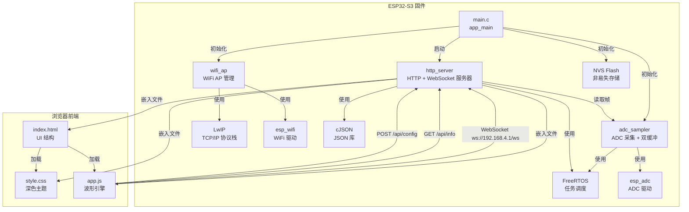

# 01 架构分析（Architecture）

> 依据：全部源文件静态分析  
> 分析时间：2026-03-19

---

## 1. 系统概览

ESP32-S3 示波器是一个**嵌入式 Web 示波器**系统，由固件（C/FreeRTOS）和浏览器前端（JavaScript/Canvas）两部分组成。

```
┌─────────────────────────────────────────────────────────────────┐
│                        ESP32-S3 芯片                             │
│                                                                  │
│  ┌──────────────────────┐    ┌──────────────────────────────┐   │
│  │      Core 1          │    │          Core 0              │   │
│  │  ┌────────────────┐  │    │  ┌────────────────────────┐  │   │
│  │  │  adc_sampler   │  │    │  │     http_server        │  │   │
│  │  │  (Task, pri=5) │  │    │  │  (httpd + ws_broadcast │  │   │
│  │  │                │  │    │  │   Task, pri=4)          │  │   │
│  │  │  ADC1_CH0(GPIO1│  │    │  │                        │  │   │
│  │  │  ADC1_CH1(GPIO2│  │    │  │  GET /                 │  │   │
│  │  └───────┬────────┘  │    │  │  GET /app.js           │  │   │
│  │          │ 双缓冲     │    │  │  GET /style.css        │  │   │
│  │          │ frame_buf  │    │  │  GET /api/info         │  │   │
│  │          │ [2]        │    │  │  POST /api/config      │  │   │
│  └──────────┼────────────┘    │  │  WS /ws               │  │   │
│             │  frame_mutex    │  └────────────────────────┘  │   │
│             └─────────────────┘                              │   │
│                                                              │   │
│  ┌──────────────────────────────────────────────────────┐   │   │
│  │                    wifi_ap                           │   │   │
│  │  SSID: Oscilloscope  IP: 192.168.4.1  WPA2-PSK      │   │   │
│  └──────────────────────────────────────────────────────┘   │   │
│                                                              │   │
│  ┌──────────────────────────────────────────────────────┐   │   │
│  │                    main.c (app_main)                 │   │   │
│  │  NVS → adc_sampler_init → wifi_ap_init →            │   │   │
│  │  http_server_start → 监控循环                        │   │   │
│  └──────────────────────────────────────────────────────┘   │   │
└─────────────────────────────────────────────────────────────────┘
                              │ WiFi 802.11
                              ▼
┌─────────────────────────────────────────────────────────────────┐
│                      浏览器（客户端）                             │
│                                                                  │
│  ┌──────────────────────────────────────────────────────────┐   │
│  │                    app.js                                │   │
│  │  WebSocket → parseFrame → applyTrigger → renderCh       │   │
│  │  Canvas CH1 (左)          Canvas CH2 (右)               │   │
│  │  calcMeas                 initControls                   │   │
│  └──────────────────────────────────────────────────────────┘   │
└─────────────────────────────────────────────────────────────────┘
```

---

## 2. 模块关系图（Mermaid）



---

## 3. 模块职责详述

### 3.1 `main.c` — 初始化编排器

- **职责**：按顺序初始化各子系统，进入监控循环
- **输入**：无（ESP-IDF 框架调用）
- **输出**：无（副作用：启动各模块）
- **依赖**：wifi_ap, http_server, adc_sampler, nvs_flash, esp_log
- **关键流程**（`app_main`，L16-L49）：
  1. NVS Flash 初始化（含擦除重试）
  2. `adc_sampler_init()` — 启动 ADC 采样任务
  3. `wifi_ap_init()` — 启动 WiFi AP
  4. `http_server_start()` — 启动 HTTP + WebSocket 服务器
  5. 无限循环：每 10 秒打印堆内存使用量

### 3.2 `wifi_ap` — WiFi 接入点管理

- **职责**：将 ESP32-S3 配置为 WiFi AP，管理客户端连接/断开事件
- **输入**：无（配置硬编码）
- **输出**：WiFi AP 就绪，IP 192.168.4.1
- **依赖**：esp_wifi, esp_netif, esp_event, lwip
- **关键配置**（`wifi_ap.c` L14-L17）：
  - SSID: `Oscilloscope`，Channel: 1，最大连接数: 4，认证: WPA2-PSK
- **事件处理**：`wifi_event_handler` 处理 `WIFI_EVENT_AP_STACONNECTED` / `STADISCONNECTED`

### 3.3 `adc_sampler` — ADC 采集模块

- **职责**：持续采集双通道 ADC 数据，存入双缓冲，供 HTTP 服务器读取
- **输入**：GPIO1 (ADC1_CH0)、GPIO2 (ADC1_CH1) 模拟信号
- **输出**：`adc_frame_t` 结构体（1024 点/通道/帧）
- **依赖**：esp_adc, freertos (task, semphr), esp_timer
- **并发模型**：
  - 运行在 **Core 1**，优先级 5
  - 双缓冲（`frame_buf[2]`）+ `frame_mutex` 保护缓冲区交换
  - `new_frame_ready` volatile 标志通知消费者

### 3.4 `http_server` — HTTP + WebSocket 服务器

- **职责**：提供 Web 界面静态文件、REST API、WebSocket 实时数据推送
- **输入**：HTTP 请求、WebSocket 连接
- **输出**：HTML/JS/CSS 文件、JSON API 响应、二进制 WebSocket 帧
- **依赖**：esp_http_server, adc_sampler, cJSON, freertos
- **并发模型**：
  - `ws_broadcast_task` 运行在 **Core 0**，优先级 4
  - 最多支持 4 个并发 WebSocket 客户端（`ws_fds[4]`）

### 3.5 `web/app.js` — 浏览器波形引擎

- **职责**：WebSocket 客户端、二进制帧解析、波形渲染、触发逻辑、自动测量
- **输入**：WebSocket 二进制帧
- **输出**：Canvas 波形图、测量值显示
- **关键特性**：
  - 双通道独立 Canvas 渲染
  - 触发（上升沿/下降沿，可调电平）
  - 自动测量（Vpp, Vmax, Vmin, Vrms, 频率）
  - 余辉效果（persistence）
  - 演示模式（WebSocket 断开时显示模拟波形）

---

## 4. 关键数据流

```
ADC 硬件 (GPIO1/GPIO2)
    │
    ▼ adc_oneshot_read() × 1024次/帧
adc_sampler_task (Core 1)
    │ 写入 frame_buf[write_idx]
    │ xSemaphoreTake(frame_mutex)
    │ 交换 write_idx ↔ read_idx
    │ new_frame_ready = true
    │ xSemaphoreGive(frame_mutex)
    ▼
frame_buf[read_idx] (双缓冲)
    │
    ▼ adc_sampler_get_frame() — 轮询
ws_broadcast_task (Core 0)
    │ pack_frame() → 二进制格式
    │   Header: magic(2B) + count(2B) + rate(4B) + ts(4B)
    │   Data:   ch1[0],ch2[0],ch1[1],ch2[1],... (uint16 LE)
    │ httpd_ws_send_frame_async() × N客户端
    ▼
WebSocket (TCP/IP / LwIP)
    │
    ▼ ws.onmessage → parseFrame()
浏览器 app.js
    │ applyTrigger() → 触发点搜索
    │ renderCh() → Canvas 绘制
    │   drawGrid() + drawWave() + drawTrigLine() + drawCursor()
    │ calcMeas() → Vpp/Vmax/Vmin/Vrms/Freq
    ▼
用户界面（双通道波形 + 测量值）
```

---

## 5. 关键控制流

### 5.1 初始化序列

```
app_main()
  ├─ nvs_flash_init()          [NVS 初始化，失败则擦除重试]
  ├─ adc_sampler_init()
  │    ├─ xSemaphoreCreateMutex()
  │    ├─ adc_oneshot_new_unit()
  │    ├─ adc_oneshot_config_channel() × 2
  │    ├─ adc_calibration_init() × 2
  │    └─ xTaskCreatePinnedToCore(adc_sampler_task, core=1, pri=5)
  ├─ wifi_ap_init()
  │    ├─ esp_netif_init()
  │    ├─ esp_event_loop_create_default()
  │    ├─ esp_netif_create_default_wifi_ap()
  │    ├─ esp_wifi_init()
  │    ├─ esp_event_handler_instance_register()
  │    └─ esp_wifi_start()
  └─ http_server_start()
       ├─ httpd_start()
       ├─ httpd_register_uri_handler() × 6
       └─ xTaskCreatePinnedToCore(ws_broadcast_task, core=0, pri=4)
```

### 5.2 运行时循环

```
[Core 1] adc_sampler_task (无限循环)
  └─ for i in 0..1023:
       adc_oneshot_read(CH0) → ch1[i]
       adc_oneshot_read(CH1) → ch2[i]
       esp_rom_delay_us(period_us)  [速率控制]
  └─ 计算实际采样率
  └─ 交换双缓冲，设置 new_frame_ready=true

[Core 0] ws_broadcast_task (无限循环)
  └─ adc_sampler_get_frame() → 若无新帧则 delay(1ms)
  └─ pack_frame() → tx_buf
  └─ for each ws_client:
       httpd_ws_send_frame_async()
       若失败则移除该客户端

[Core 0] httpd (事件驱动)
  └─ HTTP GET / → index_html_handler
  └─ HTTP GET /app.js → app_js_handler
  └─ HTTP GET /style.css → style_css_handler
  └─ HTTP GET /api/info → api_info_handler
  └─ HTTP POST /api/config → api_config_handler
  └─ WS /ws → ws_handler
```

### 5.3 退出/清理

`http_server_stop()` 函数（`http_server.c` L340-L349）：
- `httpd_stop(server)` — 停止 HTTP 服务器
- `vTaskDelete(ws_task_handle)` — 删除广播任务

> **注意**：`app_main` 中未调用 `http_server_stop()`，系统通过硬件复位退出，无软件关闭流程。

---

## 6. 模块依赖图（include 关系）

```
main.c
  ├── wifi_ap.h
  ├── http_server.h
  └── adc_sampler.h

http_server.c
  ├── http_server.h
  └── adc_sampler.h      ← 跨模块依赖（读取 ADC 帧）

wifi_ap.c
  └── wifi_ap.h

adc_sampler.c
  └── adc_sampler.h
```

> 依据：各 `.c` 文件顶部 `#include` 指令

---

## 7. FreeRTOS 任务一览

| 任务名 | 函数 | 核心 | 优先级 | 栈大小 | 说明 |
|--------|------|------|--------|--------|------|
| `adc_sampler` | `adc_sampler_task` | Core 1 | 5 | 4096 B | ADC 采集 |
| `ws_broadcast` | `ws_broadcast_task` | Core 0 | 4 | 8192 B | WebSocket 广播 |
| `httpd` | ESP-IDF 内部 | Core 0 | — | 8192 B | HTTP 请求处理 |
| `main` | `app_main` | Core 0 | — | 8192 B | 初始化 + 监控 |

> 依据：`adc_sampler.c` L175-L183，`http_server.c` L316-L324，`sdkconfig.defaults` L37