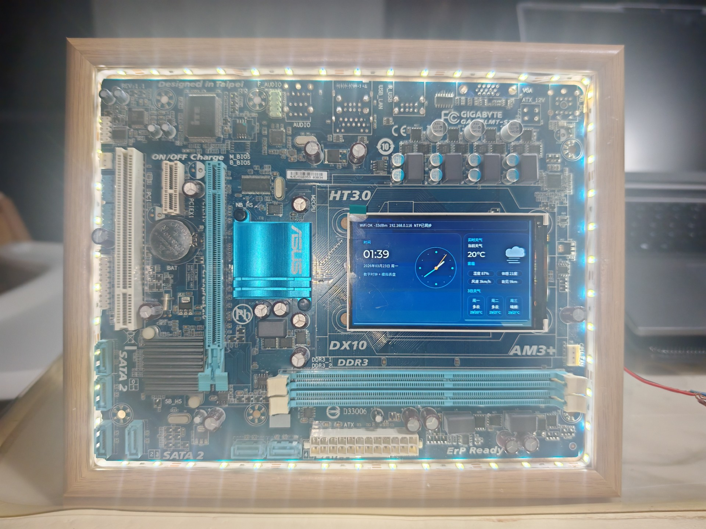

# ESP32-S3 Desk Clock

[](https://docs.espressif.com/projects/esp-idf/en/latest/)
[](https://lvgl.io/)
[]()
[]()

## 效果展示



基于 ESP32-S3 的桌面时钟项目，提供 800x480 大屏时钟界面、Wi-Fi 联网、NTP 自动对时、QWeather 实时天气和 3 日预报，并且已经支持两套显示硬件路径：

- `Waveshare ESP32-S3-Touch-LCD-7`，RGB 屏直刷路径，默认配置
- `Generic NT35510 I80 Board`，支持 8/16-bit I80 总线，适合通用 NT35510 屏

当前显示层已经切换到 `LVGL`，UI 包含数字时钟、模拟表盘、状态栏、天气详情卡片和 3 日天气卡片。

## 当前功能

- `LVGL 9.2.2` UI，适配 `800x480 RGB565`
- 数字时钟 + 模拟表盘联动刷新
- Wi-Fi STA 自动连接和断线重连
- NTP 自动同步，本地时区为 `CST-8`
- QWeather HTTPS 请求
- 实时天气：温度、体感、湿度、风速、能见度
- 3 日天气预报
- 中文天气文案和自定义中文字体
- LCD 诊断模式，可循环显示 4 组测试图案
- UI-only 模式，可单独验证 LVGL 渲染链路
- 配置支持编译期默认值 + NVS 覆盖

## 硬件支持

### 1. Waveshare ESP32-S3-Touch-LCD-7

这是当前默认目标板。

- 接口：`RGB 16-bit`
- 分辨率：`800x480`
- 渲染模式：`LVGL direct mode`
- 帧缓冲：双缓冲，存放于 `PSRAM`
- 背光/复位控制：通过板载 `CH422G` 扩展 IO

默认 RGB 引脚定义位于 [main/config.h](/D:/workspace/esp32_desk_clock/main/config.h)。

### 2. Generic NT35510 I80 Board

新增的通用 `NT35510` 支持通过 `menuconfig` 配置：

- 分辨率
- I80 像素时钟
- `8-bit / 16-bit` 总线宽度
- 颜色顺序 `RGB / BGR`
- `swap_xy / mirror_x / mirror_y / invert_color`
- RGB565 字节交换
- `WR / CS / DC / RST / BK / POWER / D0~D15` 引脚

这一路径使用 `LVGL partial mode`，并按 `draw buffer lines` 分块刷新，更适合通用并口屏。

相关配置入口见 [main/Kconfig.projbuild](/D:/workspace/esp32_desk_clock/main/Kconfig.projbuild)。

## 软件架构

```text
esp32_desk_clock/
├── main/
│   ├── main.c                  # 启动流程与任务创建
│   ├── config.h                # 固件、板型、网络、天气等全局配置
│   ├── Kconfig.projbuild       # 板型与 NT35510 参数菜单
│   ├── certs/
│   │   └── isrg_root_x1.pem    # HTTPS 证书
│   ├── lcd/
│   │   ├── lcd_driver.c        # RGB / I80 显示驱动统一封装
│   │   └── waveshare_board.c   # Waveshare 板级控制
│   ├── net/
│   │   ├── wifi_manager.c      # Wi-Fi STA
│   │   ├── ntp_client.c        # SNTP 同步
│   │   └── weather_client.c    # QWeather HTTPS 客户端
│   ├── storage/
│   │   └── config_store.c      # NVS 配置读取
│   └── ui/
│       ├── ui_renderer.c       # LVGL UI 与刷新逻辑
│       └── ui_font_noto_sc_16.c
├── sdkconfig.defaults
├── sdkconfig.nt35510.defaults  # NT35510 构建示例默认值
└── partitions.csv
```

## 运行模式

启动模式在 [main/config.h](/D:/workspace/esp32_desk_clock/main/config.h) 中通过 `SYSTEM_BOOT_MODE` 选择：

- `BOOT_MODE_FULL_APP`：默认模式，启动 Wi-Fi、NTP、天气和 UI
- `BOOT_MODE_UI_ONLY`：只启动 UI，适合验证显示链路
- `BOOT_MODE_LCD_DIAGNOSTIC`：循环显示测试图案，适合排查花屏、颜色错位、走线问题

## 配置说明

### 1. Wi-Fi 与天气

默认编译配置位于 [main/config.h](/D:/workspace/esp32_desk_clock/main/config.h)：

```c
#define CONFIG_WIFI_SSID_DEFAULT    "your_ssid"
#define CONFIG_WIFI_PASS_DEFAULT    "your_password"

#define WEATHER_API_KEY             "your_qweather_key"
#define WEATHER_LOCATION_ID         "101280601"
#define WEATHER_API_HOST            "your-qweather-host"
```

说明：

- `WEATHER_API_HOST` 需要填写你在和风天气控制台分配的 Host
- Wi-Fi、天气 Key、城市 ID 都支持从 NVS 读取覆盖默认值
- 当前代码会在首次天气请求前等待有效 NTP 时间，避免 HTTPS 因系统时间错误而失败

### 2. TLS 与证书

项目已经内嵌证书文件 [main/certs/isrg_root_x1.pem](/D:/workspace/esp32_desk_clock/main/certs/isrg_root_x1.pem)，并在天气客户端中预留了证书校验路径。

但当前默认配置 [sdkconfig.defaults](/D:/workspace/esp32_desk_clock/sdkconfig.defaults) 中启用了：

- `CONFIG_ESP_TLS_INSECURE=y`
- `CONFIG_ESP_TLS_SKIP_SERVER_CERT_VERIFY=y`

也就是说，仓库默认构建更偏向“先跑通 HTTPS 请求”。如果你要启用服务端证书校验，需要在 `menuconfig` 中关闭上述两个选项。

### 3. 存储

项目目前会从 NVS 中读取这些键：

- `wifi_cfg/ssid`
- `wifi_cfg/pass`
- `desk_clock/brightness`
- `desk_clock/city_id`
- `desk_clock/api_key`

目前代码里已经使用了亮度、城市 ID、API Key 的读取路径，但仓库内没有提供独立的配置 UI。

## 构建

### 默认构建：Waveshare 7 寸 RGB 板

```powershell
idf.py set-target esp32s3
idf.py build
```

烧录：

```powershell
idf.py -p COMx flash monitor
```

### 切换到 NT35510 I80 板

方式一：使用 `menuconfig`

```powershell
idf.py menuconfig
```

然后进入 `Desk Clock Hardware`：

- 选择 `Generic NT35510 I80 board`
- 配置分辨率、总线宽度、时钟、镜像和引脚

方式二：使用示例默认值文件 [sdkconfig.nt35510.defaults](/D:/workspace/esp32_desk_clock/sdkconfig.nt35510.defaults)

```powershell
$env:SDKCONFIG_DEFAULTS="sdkconfig.defaults;sdkconfig.nt35510.defaults"
idf.py build
```

说明：

- `sdkconfig.nt35510.defaults` 里的引脚仅作为示例，烧录前必须按你的硬件修改
- 如果仓库里已经存在 `sdkconfig`，则现有 `sdkconfig` 的内容优先

## 显示实现差异

### RGB 路径

- 驱动文件：[main/lcd/lcd_driver.c](/D:/workspace/esp32_desk_clock/main/lcd/lcd_driver.c)
- 使用 `esp_lcd RGB panel`
- 双全屏帧缓冲
- `LVGL direct mode`
- 刷新完成通过 RGB 面板回调通知

### NT35510 I80 路径

- 驱动文件：[main/lcd/lcd_driver.c](/D:/workspace/esp32_desk_clock/main/lcd/lcd_driver.c)
- 使用 `esp_lcd i80 bus + nt35510 panel`
- 双分块 DMA buffer
- `LVGL partial mode`
- 支持 RGB565 字节交换
- 支持电源脚和背光脚独立控制

## 天气接口说明

天气客户端位于 [main/net/weather_client.c](/D:/workspace/esp32_desk_clock/main/net/weather_client.c)。

当前实现特性：

- 使用 HTTPS 访问 QWeather `v7/weather/now`
- 使用 HTTPS 访问 QWeather `v7/weather/3d`
- 支持 gzip 响应解压
- 在 TLS 失败时输出更详细的诊断日志
- 首次联网后等待有效系统时间，再发起天气请求

## 默认资源要求

- `ESP32-S3`
- `16MB Flash`
- `PSRAM`
- 推荐 `8MB PSRAM` 或更高

分区表见 [partitions.csv](/D:/workspace/esp32_desk_clock/partitions.csv)，当前为单应用分区：

- `nvs`
- `phy_init`
- `factory`

## 已知注意点

- Waveshare 板的背光不是普通 GPIO，实际由 `CH422G` 控制
- NT35510 示例默认值主要用于快速编译验证，不保证与你的板卡完全匹配
- 当前天气接口默认更新周期为 `3600s`
- 当前 UI 天气文字刷新周期为 `30s`，显示的是最近一次缓存结果
- 旧版 README 中关于“自绘 UI / 旧引脚图 / 30 分钟天气更新”的描述已经不再准确

## 许可证

MIT License
