# MCP 銉欍兗銈广伄銉併儯銉冦儓銉溿儍銉?

锛堟棩鏈獮 | [涓枃](README_zh.md) | [English](README.md)锛?

## 銇仒銈併伀

馃憠 [浜洪枔锛欰I銇偒銉°儵銈掕鐫€ vs AI锛氥仢銇牬銇ч＜銇勪富銇?鏃ラ枔楂倰娲椼仯銇︺亜銇亜銇撱仺銈掔櫤瑕嬨€恇ilibili銆慮(https://www.bilibili.com/video/BV1bpjgzKEhd/)

馃憠 [鎵嬩綔銈娿仹AI銈兗銉儠銉兂銉夈倰浣溿倠銆佸垵蹇冭€呭叆闁€銉併儱銉笺儓銉偄銉€恇ilibili銆慮(https://www.bilibili.com/video/BV1XnmFYLEJN/)

銈枫儯銈偢銉糀I銉併儯銉冦儓銉溿儍銉堛伅闊冲０銈ゃ兂銈裤儵銈偡銉с兂銇叆鍙ｃ仺銇椼仸銆丵wen / DeepSeek銇仼銇ぇ瑕忔ā銉儑銉伄AI鑳藉姏銈掓椿鐢ㄣ仐銆丮CP銉椼儹銉堛偝銉倰閫氥仒銇︺優銉儊銈ㄣ兂銉夊埗寰°倰瀹熺従銇椼伨銇欍€?

## 銉愩兗銈搞儳銉炽儙銉笺儓

鐝惧湪銇畍2銉愩兗銈搞儳銉炽伅v1銉戙兗銉嗐偅銈枫儳銉炽儐銉笺儢銉仺浜掓彌鎬с亴銇亜銇熴倎銆乿1銇嬨倝v2銇窸TA銇с偄銉冦儣銈般儸銉笺儔銇欍倠銇撱仺銇仹銇嶃伨銇涖倱銆傘儜銉笺儐銈ｃ偡銉с兂銉嗐兗銉栥儷銇┏绱般伀銇ゃ亜銇︺伅銆乕partitions/v2/README.md](partitions/v2/README.md)銈掋仈鍙傜収銇忋仩銇曘亜銆?

v1銈掑疅琛屻仐銇︺亜銈嬨仚銇广仸銇儚銉笺儔銈︺偋銈伅銆併儠銈°兗銉犮偊銈с偄銈掓墜鍕曘仹鏇搞亶杈笺個銇撱仺銇2銇偄銉冦儣銈般儸銉笺儔銇с亶銇俱仚銆?

v1銇畨瀹氱増銇?.9.2銇с仚銆俙git checkout v1`銇1銇垏銈婃浛銇堛倠銇撱仺銇屻仹銇嶃伨銇欍€倂1銉栥儵銉炽儊銇?026骞?鏈堛伨銇х稒缍氱殑銇儭銉炽儐銉娿兂銈广仌銈屻伨銇欍€?

### 瀹熻娓堛伩姗熻兘

- Wi-Fi / ML307 Cat.1 4G
- 銈儠銉┿偆銉抽煶澹般偊銈с偆銈偄銉冦儣 [ESP-SR](https://github.com/espressif/esp-sr)
- 2绋銇€氫俊銉椼儹銉堛偝銉伀瀵惧繙锛圼Websocket](docs/websocket.md) 銇俱仧銇?MQTT+UDP锛?
- OPUS銈兗銉囥偅銈偝銉笺儑銉冦偗銈掓帯鐢?
- 銈广儓銉兗銉熴兂銈癆SR + LLM + TTS銈兗銈儐銈儊銉ｃ伀鍩恒仴銇忛煶澹般偆銉炽偪銉┿偗銈枫儳銉?
- 瑭辫€呰獚璀樸€佺従鍦ㄨ┍銇椼仸銇勩倠浜恒倰璀樺垾 [3D Speaker](https://github.com/modelscope/3D-Speaker)
- OLED / LCD銉囥偅銈广儣銉偆銆佽〃鎯呰〃绀哄蹇?
- 銉愩儍銉嗐儶銉艰〃绀恒仺闆绘簮绠＄悊
- 澶氳█瑾炲蹇滐紙涓浗瑾炪€佽嫳瑾炪€佹棩鏈獮锛?
- ESP32-C3銆丒SP32-S3銆丒SP32-P4銉併儍銉椼儣銉┿儍銉堛儠銈┿兗銉犲蹇?
- 銉囥儛銈ゃ偣鍋碝CP銇倛銈嬨儑銉愩偆銈瑰埗寰★紙闊抽噺銉绘槑銈嬨仌瑾挎暣銆併偄銈偡銉с兂鍒跺尽銇仼锛?
- 銈儵銈︺儔鍋碝CP銇уぇ瑕忔ā銉儑銉兘鍔涖倰鎷″嫉锛堛偣銉炪兗銉堛儧銉笺儬鍒跺尽銆丳C銉囥偣銈儓銉冦儣鎿嶄綔銆佺煡璀樻绱€併儭銉笺儷閫佸彈淇°仾銇╋級
- 銈偣銈裤優銈ゃ偤鍙兘銇偊銈с偆銈儻銉笺儔銆併儠銈┿兂銉堛€佺档鏂囧瓧銆併儊銉ｃ儍銉堣儗鏅€併偑銉炽儵銈ゃ兂Web绶ㄩ泦銇蹇?([銈偣銈裤儬銈偦銉冦儓銈搞偋銉嶃儸銉笺偪銉糫(https://github.com/78/xiaozhi-assets-generator))

## 銉忋兗銉夈偊銈с偄

### 銉栥儸銉冦儔銉溿兗銉夋墜浣溿倞瀹熻返

Feishu銉夈偔銉ャ儭銉炽儓銉併儱銉笺儓銉偄銉倰銇旇Η銇忋仩銇曘亜锛?

馃憠 [銆屻偡銉ｃ偑銈搞兗AI銉併儯銉冦儓銉溿儍銉堢櫨绉戜簨鍏搞€峕(https://ccnphfhqs21z.feishu.cn/wiki/F5krwD16viZoF0kKkvDcrZNYnhb?from=from_copylink)

銉栥儸銉冦儔銉溿兗銉夈伄銉囥儮锛?

![銉栥儸銉冦儔銉溿兗銉夈儑銉(docs/v1/wiring2.jpg)

### 70绋浠ヤ笂銇偑銉笺儣銉炽偨銉笺偣銉忋兗銉夈偊銈с偄銇蹇滐紙涓€閮ㄣ伄銇胯〃绀猴級

- <a href="https://oshwhub.com/li-chuang-kai-fa-ban/li-chuang-shi-zhan-pai-esp32-s3-kai-fa-ban" target="_blank" title="绔嬪壍銉诲疅鎴︽淳 ESP32-S3 闁嬬櫤銉溿兗銉?>绔嬪壍銉诲疅鎴︽淳 ESP32-S3 闁嬬櫤銉溿兗銉?/a>
- <a href="https://github.com/espressif/esp-box" target="_blank" title="妤介懌 ESP32-S3-BOX3">妤介懌 ESP32-S3-BOX3</a>
- <a href="https://docs.m5stack.com/zh_CN/core/CoreS3" target="_blank" title="M5Stack CoreS3">M5Stack CoreS3</a>
- <a href="https://docs.m5stack.com/en/atom/Atomic%20Echo%20Base" target="_blank" title="AtomS3R + Echo Base">M5Stack AtomS3R + Echo Base</a>
- <a href="https://gf.bilibili.com/item/detail/1108782064" target="_blank" title="銉炪偢銉冦偗銉溿偪銉?.4">銉炪偢銉冦偗銉溿偪銉?.4</a>
- <a href="https://www.waveshare.net/shop/ESP32-S3-Touch-AMOLED-1.8.htm" target="_blank" title="寰洩闆诲瓙 ESP32-S3-Touch-AMOLED-1.8">寰洩闆诲瓙 ESP32-S3-Touch-AMOLED-1.8</a>
- <a href="https://github.com/Xinyuan-LilyGO/T-Circle-S3" target="_blank" title="LILYGO T-Circle-S3">LILYGO T-Circle-S3</a>
- <a href="https://oshwhub.com/tenclass01/xmini_c3" target="_blank" title="銈ㄣ儞鍏勩仌銈?Mini C3">銈ㄣ儞鍏勩仌銈?Mini C3</a>
- <a href="https://oshwhub.com/movecall/cuican-ai-pendant-lights-up-y" target="_blank" title="Movecall CuiCan ESP32S3">CuiCan AI銉氥兂銉€銉炽儓</a>
- <a href="https://github.com/WMnologo/xingzhi-ai" target="_blank" title="鐒″悕绉戞妧Nologo-鏄熸櫤-1.54">鐒″悕绉戞妧Nologo-鏄熸櫤-1.54TFT</a>
- <a href="https://www.seeedstudio.com/SenseCAP-Watcher-W1-A-p-5979.html" target="_blank" title="SenseCAP Watcher">SenseCAP Watcher</a>
- <a href="https://www.bilibili.com/video/BV1BHJtz6E2S/" target="_blank" title="ESP-HI 瓒呬綆銈炽偣銉堛儹銉溿儍銉堢姮">ESP-HI 瓒呬綆銈炽偣銉堛儹銉溿儍銉堢姮</a>

  <a href="docs/v1/lichuang-s3.jpg" target="_blank" title="绔嬪壍銉诲疅鎴︽淳 ESP32-S3 闁嬬櫤銉溿兗銉?>
    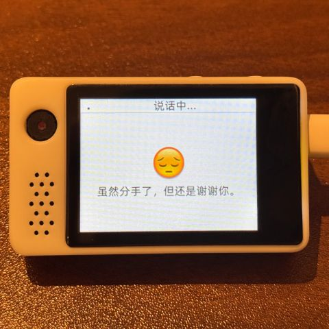
  </a>
  <a href="docs/v1/espbox3.jpg" target="_blank" title="妤介懌 ESP32-S3-BOX3">
    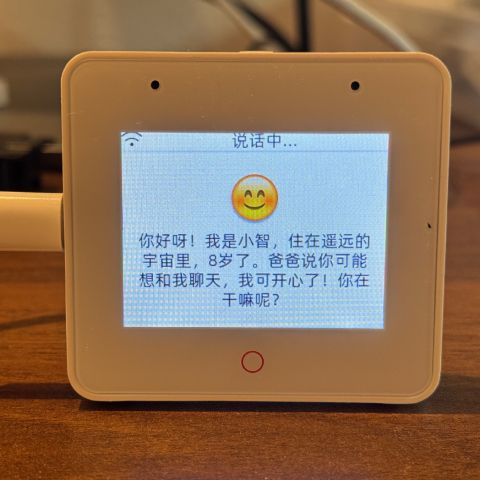
  </a>
  <a href="docs/v1/m5cores3.jpg" target="_blank" title="M5Stack CoreS3">
    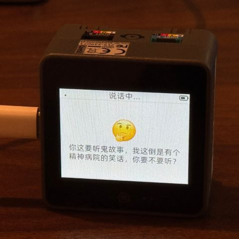
  </a>
  <a href="docs/v1/atoms3r.jpg" target="_blank" title="AtomS3R + Echo Base">
    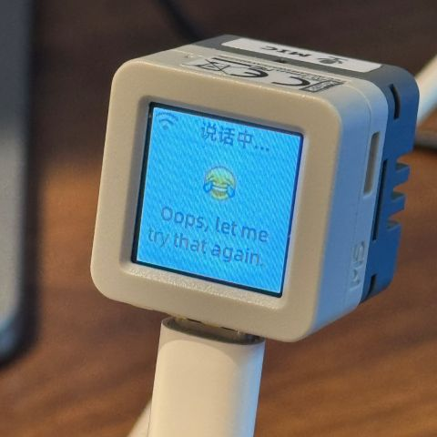
  </a>
  <a href="docs/v1/magiclick.jpg" target="_blank" title="銉炪偢銉冦偗銉溿偪銉?.4">
    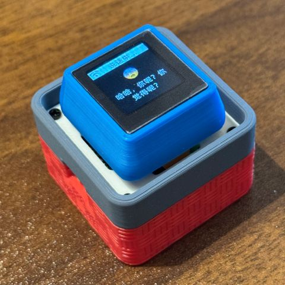
  </a>
  <a href="docs/v1/waveshare.jpg" target="_blank" title="寰洩闆诲瓙 ESP32-S3-Touch-AMOLED-1.8">
    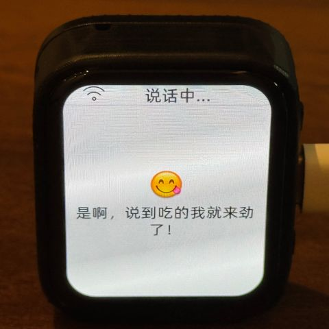
  </a>
  <a href="docs/v1/lilygo-t-circle-s3.jpg" target="_blank" title="LILYGO T-Circle-S3">
    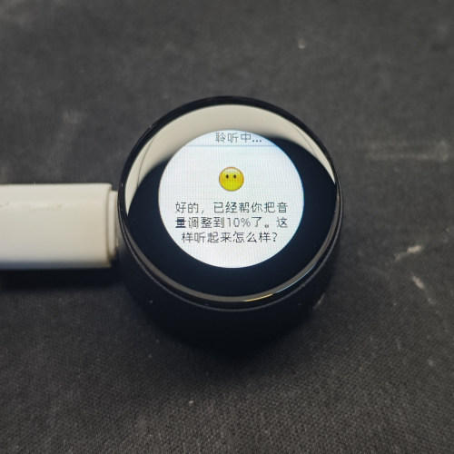
  </a>
  <a href="docs/v1/xmini-c3.jpg" target="_blank" title="銈ㄣ儞鍏勩仌銈?Mini C3">
    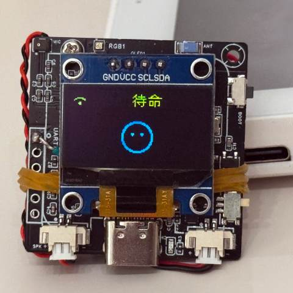
  </a>
  <a href="docs/v1/movecall-cuican-esp32s3.jpg" target="_blank" title="CuiCan">
    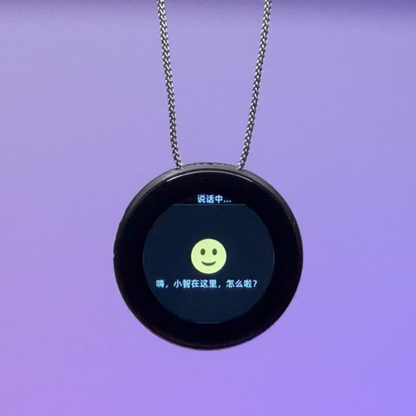
  </a>
  <a href="docs/v1/wmnologo_xingzhi_1.54.jpg" target="_blank" title="鐒″悕绉戞妧Nologo-鏄熸櫤-1.54">
    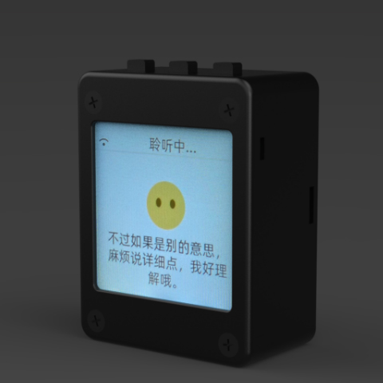
  </a>
  <a href="docs/v1/sensecap_watcher.jpg" target="_blank" title="SenseCAP Watcher">
    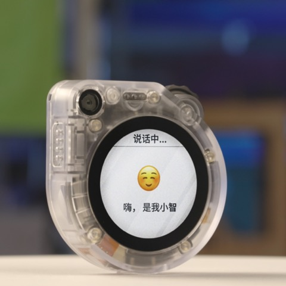
  </a>
  <a href="docs/v1/esp-hi.jpg" target="_blank" title="ESP-HI 瓒呬綆銈炽偣銉堛儹銉溿儍銉堢姮">
    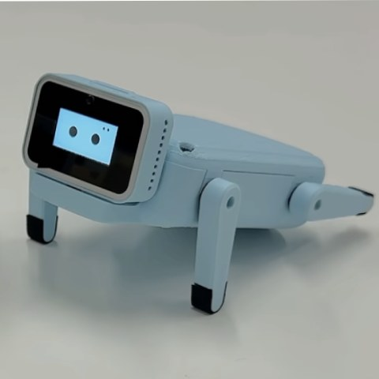
  </a>

## 銈姐儠銉堛偊銈с偄

### 銉曘偂銉笺儬銈︺偋銈㈡浉銇嶈炯銇?

鍒濆績鑰呫伄鏂广伅銆併伨銇氶枊鐧虹挵澧冦倰妲嬬瘔銇涖仛銇浉銇嶈炯銇垮彲鑳姐仾銉曘偂銉笺儬銈︺偋銈倰浣跨敤銇欍倠銇撱仺銈掋亰銇欍仚銈併仐銇俱仚銆?

銉曘偂銉笺儬銈︺偋銈伅銉囥儠銈┿儷銉堛仹鍏紡 [xiaozhi.me](https://xiaozhi.me) 銈点兗銉愩兗銇帴缍氥仐銇俱仚銆傚€嬩汉銉︺兗銈躲兗銇偄銈偊銉炽儓鐧婚尣銇wen銉偄銉偪銈ゃ儬銉儑銉倰鐒℃枡銇у埄鐢ㄣ仹銇嶃伨銇欍€?

馃憠 [鍒濆績鑰呭悜銇戙儠銈°兗銉犮偊銈с偄鏇搞亶杈笺伩銈偆銉塢(https://ccnphfhqs21z.feishu.cn/wiki/Zpz4wXBtdimBrLk25WdcXzxcnNS)

### 闁嬬櫤鐠板

- Cursor 銇俱仧銇?VSCode
- ESP-IDF銉椼儵銈般偆銉炽倰銈ゃ兂銈广儓銉笺儷銇椼€丼DK銉愩兗銈搞儳銉?.4浠ヤ笂銈掗伕鎶?
- Linux銇疻indows銈堛倞銈傚劒銈屻仸銇娿倞銆併偝銉炽儜銈ゃ儷銇岄€熴亸銆併儔銉┿偆銉愩伄鍟忛銈傚皯銇亜
- 鏈儣銉偢銈с偗銉堛伅Google C++銈炽兗銉夈偣銈裤偆銉倰鎺＄敤銆併偝銉笺儔鎻愬嚭鏅傘伅婧栨嫚銈掔⒑瑾嶃仐銇︺亸銇犮仌銇?

### 闁嬬櫤鑰呫儔銈儱銉°兂銉?

- [MCP銉椼儹銉堛偝銉獻oT鍒跺尽浣跨敤娉昡(docs/mcp-usage.md) - MCP銉椼儹銉堛偝銉仹IoT銉囥儛銈ゃ偣銈掑埗寰°仚銈嬫柟娉?
- [MCP銉椼儹銉堛偝銉偆銉炽偪銉┿偗銈枫儳銉炽儠銉兗](docs/mcp-protocol.md) - 銉囥儛銈ゃ偣鍋碝CP銉椼儹銉堛偝銉伄瀹熻鏂规硶
- [MQTT + UDP 銉忋偆銉栥儶銉冦儔閫氫俊銉椼儹銉堛偝銉儔銈儱銉°兂銉圿(docs/mqtt-udp.md)
- [瑭崇窗銇猈ebSocket閫氫俊銉椼儹銉堛偝銉儔銈儱銉°兂銉圿(docs/websocket.md)

## 澶ц妯°儮銉囥儷瑷畾

銇欍仹銇偡銉ｃ偑銈搞兗AI銉併儯銉冦儓銉溿儍銉堛儑銉愩偆銈广倰銇婃寔銇°仹銆佸叕寮忋偟銉笺儛銉笺伀鎺ョ稓娓堛伩銇牬鍚堛伅銆乕xiaozhi.me](https://xiaozhi.me) 銈炽兂銈姐兗銉仹瑷畾銇с亶銇俱仚銆?

馃憠 [銉愩儍銈偍銉炽儔鎿嶄綔銉撱儑銈儊銉ャ兗銉堛儶銈儷锛堟棫銈ゃ兂銈裤兗銉曘偋銉笺偣锛塢(https://www.bilibili.com/video/BV1jUCUY2EKM/)

## 闁㈤€ｃ偑銉笺儣銉炽偨銉笺偣銉椼儹銈搞偋銈儓

鍊嬩汉PC銇с偟銉笺儛銉笺倰銉囥儣銉偆銇欍倠鍫村悎銇€佷互涓嬨伄銈兗銉椼兂銈姐兗銈广儣銉偢銈с偗銉堛倰鍙傜収銇椼仸銇忋仩銇曘亜锛?

- [xinnan-tech/xiaozhi-esp32-server](https://github.com/xinnan-tech/xiaozhi-esp32-server) Python銈点兗銉愩兗
- [joey-zhou/xiaozhi-esp32-server-java](https://github.com/joey-zhou/xiaozhi-esp32-server-java) Java銈点兗銉愩兗
- [AnimeAIChat/xiaozhi-server-go](https://github.com/AnimeAIChat/xiaozhi-server-go) Golang銈点兗銉愩兗
- [hackers365/xiaozhi-esp32-server-golang](https://github.com/hackers365/xiaozhi-esp32-server-golang) Golang銈点兗銉愩兗

銈枫儯銈偢銉奸€氫俊銉椼儹銉堛偝銉倰鍒╃敤銇椼仧浠栥伄銈儵銈ゃ偄銉炽儓銉椼儹銈搞偋銈儓锛?

- [huangjunsen0406/py-xiaozhi](https://github.com/huangjunsen0406/py-xiaozhi) Python銈儵銈ゃ偄銉炽儓
- [TOM88812/xiaozhi-android-client](https://github.com/TOM88812/xiaozhi-android-client) Android銈儵銈ゃ偄銉炽儓
- [100askTeam/xiaozhi-linux](http://github.com/100askTeam/xiaozhi-linux) 鐧惧晱绉戞妧鎻愪緵銇甃inux銈儵銈ゃ偄銉炽儓
- [78/xiaozhi-sf32](https://github.com/78/xiaozhi-sf32) 鎬濇緢绉戞妧銇瓸luetooth銉併儍銉椼儠銈°兗銉犮偊銈с偄
- [QuecPython/solution-xiaozhiAI](https://github.com/QuecPython/solution-xiaozhiAI) 绉婚仩鎻愪緵銇甉uecPython銉曘偂銉笺儬銈︺偋銈?

## 銉椼儹銈搞偋銈儓銇仱銇勩仸

銇撱倢銇偍銉撳厔銇曘倱銇屻偑銉笺儣銉炽偨銉笺偣銇у叕闁嬨仐銇︺亜銈婨SP32銉椼儹銈搞偋銈儓銇с€丮IT銉┿偆銈汇兂銈广伄銈傘仺銆佽銇с倐鐒℃枡銇с€佸晢鐢ㄥ埄鐢ㄣ倐鍙兘銇с仚銆?

銇撱伄銉椼儹銈搞偋銈儓銈掗€氥仒銇︺€丄I銉忋兗銉夈偊銈с偄闁嬬櫤銈掔悊瑙ｃ仐銆佹€ラ€熴伀閫插寲銇欍倠澶ц妯¤█瑾炪儮銉囥儷銈掑疅闅涖伄銉忋兗銉夈偊銈с偄銉囥儛銈ゃ偣銇繙鐢ㄣ仹銇嶃倠銈堛亞銇仾銈嬨亾銇ㄣ倰鐩寚銇椼仸銇勩伨銇欍€?

銇旀剰瑕嬨倓銇旀彁妗堛亴銇傘倢銇般€併亜銇ゃ仹銈侷ssue銈掓彁鍑恒仚銈嬨亱銆乕Discord](https://discord.gg/bXqgAfRm) 銇俱仧銇?QQ銈般儷銉笺儣锛?011329060 銇仈鍙傚姞銇忋仩銇曘亜銆?

## 銈广偪銉煎饱姝?

<a href="https://star-history.com/#78/xiaozhi-esp32&Date">
 <picture>
   <source media="(prefers-color-scheme: dark)" srcset="https://api.star-history.com/svg?repos=78/xiaozhi-esp32&type=Date&theme=dark" />
   <source media="(prefers-color-scheme: light)" srcset="https://api.star-history.com/svg?repos=78/xiaozhi-esp32&type=Date" />
   
 </picture>
</a> 
