# An MCP-based Chatbot

锛堜腑鏂?| [English](README.md) | [鏃ユ湰瑾瀅(README_ja.md)锛?

## 浠嬬粛

馃憠 [浜虹被锛氱粰 AI 瑁呮憚鍍忓ご vs AI锛氬綋鍦哄彂鐜颁富浜轰笁澶╂病娲楀ご銆恇ilibili銆慮(https://www.bilibili.com/video/BV1bpjgzKEhd/)

馃憠 [鎵嬪伐鎵撻€犱綘鐨?AI 濂冲弸锛屾柊鎵嬪叆闂ㄦ暀绋嬨€恇ilibili銆慮(https://www.bilibili.com/video/BV1XnmFYLEJN/)

灏忔櫤 AI 鑱婂ぉ鏈哄櫒浜轰綔涓轰竴涓闊充氦浜掑叆鍙ｏ紝鍒╃敤 Qwen / DeepSeek 绛夊ぇ妯″瀷鐨?AI 鑳藉姏锛岄€氳繃 MCP 鍗忚瀹炵幇澶氱鎺у埗銆?

### 鐗堟湰璇存槑

褰撳墠 v2 鐗堟湰涓?v1 鐗堟湰鍒嗗尯琛ㄤ笉鍏煎锛屾墍浠ユ棤娉曚粠 v1 鐗堟湰閫氳繃 OTA 鍗囩骇鍒?v2 鐗堟湰銆傚垎鍖鸿〃璇存槑鍙傝 [partitions/v2/README.md](partitions/v2/README.md)銆?

浣跨敤 v1 鐗堟湰鐨勬墍鏈夌‖浠讹紝鍙互閫氳繃鎵嬪姩鐑у綍鍥轰欢鏉ュ崌绾у埌 v2 鐗堟湰銆?

v1 鐨勭ǔ瀹氱増鏈负 1.9.2锛屽彲浠ラ€氳繃 `git checkout v1` 鏉ュ垏鎹㈠埌 v1 鐗堟湰锛岃鍒嗘敮浼氭寔缁淮鎶ゅ埌 2026 骞?2 鏈堛€?

### 宸插疄鐜板姛鑳?

- Wi-Fi / ML307 Cat.1 4G
- 绂荤嚎璇煶鍞ら啋 [ESP-SR](https://github.com/espressif/esp-sr)
- 鏀寔涓ょ閫氫俊鍗忚锛圼Websocket](docs/websocket.md) 鎴?MQTT+UDP锛?
- 閲囩敤 OPUS 闊抽缂栬В鐮?
- 鍩轰簬娴佸紡 ASR + LLM + TTS 鏋舵瀯鐨勮闊充氦浜?
- 澹扮汗璇嗗埆锛岃瘑鍒綋鍓嶈璇濅汉鐨勮韩浠?[3D Speaker](https://github.com/modelscope/3D-Speaker)
- OLED / LCD 鏄剧ず灞忥紝鏀寔琛ㄦ儏鏄剧ず
- 鐢甸噺鏄剧ず涓庣數婧愮鐞?
- 鏀寔澶氳瑷€锛堜腑鏂囥€佽嫳鏂囥€佹棩鏂囷級
- 鏀寔 ESP32-C3銆丒SP32-S3銆丒SP32-P4 鑺墖骞冲彴
- 閫氳繃璁惧绔?MCP 瀹炵幇璁惧鎺у埗锛堥煶閲忋€佺伅鍏夈€佺數鏈恒€丟PIO 绛夛級
- 閫氳繃浜戠 MCP 鎵╁睍澶фā鍨嬭兘鍔涳紙鏅鸿兘瀹跺眳鎺у埗銆丳C妗岄潰鎿嶄綔銆佺煡璇嗘悳绱€侀偖浠舵敹鍙戠瓑锛?
- 鑷畾涔夊敜閱掕瘝銆佸瓧浣撱€佽〃鎯呬笌鑱婂ぉ鑳屾櫙锛屾敮鎸佺綉椤电鍦ㄧ嚎淇敼 ([鑷畾涔堿ssets鐢熸垚鍣╙(https://github.com/78/xiaozhi-assets-generator))

## 纭欢

### 闈㈠寘鏉挎墜宸ュ埗浣滃疄璺?

璇﹁椋炰功鏂囨。鏁欑▼锛?

馃憠 [銆婂皬鏅?AI 鑱婂ぉ鏈哄櫒浜虹櫨绉戝叏涔︺€媇(https://ccnphfhqs21z.feishu.cn/wiki/F5krwD16viZoF0kKkvDcrZNYnhb?from=from_copylink)

闈㈠寘鏉挎晥鏋滃浘濡備笅锛?

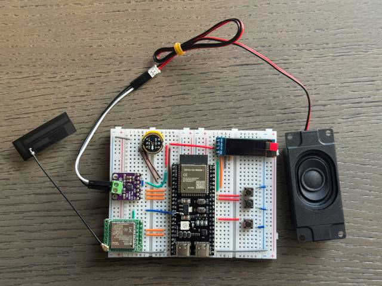

### 鏀寔 70 澶氫釜寮€婧愮‖浠讹紙浠呭睍绀洪儴鍒嗭級

- <a href="https://oshwhub.com/li-chuang-kai-fa-ban/li-chuang-shi-zhan-pai-esp32-s3-kai-fa-ban" target="_blank" title="绔嬪垱路瀹炴垬娲?ESP32-S3 寮€鍙戞澘">绔嬪垱路瀹炴垬娲?ESP32-S3 寮€鍙戞澘</a>
- <a href="https://github.com/espressif/esp-box" target="_blank" title="涔愰懌 ESP32-S3-BOX3">涔愰懌 ESP32-S3-BOX3</a>
- <a href="https://docs.m5stack.com/zh_CN/core/CoreS3" target="_blank" title="M5Stack CoreS3">M5Stack CoreS3</a>
- <a href="https://docs.m5stack.com/en/atom/Atomic%20Echo%20Base" target="_blank" title="AtomS3R + Echo Base">M5Stack AtomS3R + Echo Base</a>
- <a href="https://gf.bilibili.com/item/detail/1108782064" target="_blank" title="绁炲鎸夐挳 2.4">绁炲鎸夐挳 2.4</a>
- <a href="https://www.waveshare.net/shop/ESP32-S3-Touch-AMOLED-1.8.htm" target="_blank" title="寰洩鐢靛瓙 ESP32-S3-Touch-AMOLED-1.8">寰洩鐢靛瓙 ESP32-S3-Touch-AMOLED-1.8</a>
- <a href="https://github.com/Xinyuan-LilyGO/T-Circle-S3" target="_blank" title="LILYGO T-Circle-S3">LILYGO T-Circle-S3</a>
- <a href="https://oshwhub.com/tenclass01/xmini_c3" target="_blank" title="铏惧摜 Mini C3">铏惧摜 Mini C3</a>
- <a href="https://oshwhub.com/movecall/cuican-ai-pendant-lights-up-y" target="_blank" title="Movecall CuiCan ESP32S3">鐠€鐠稟I 鍚婂潬</a>
- <a href="https://github.com/WMnologo/xingzhi-ai" target="_blank" title="鏃犲悕绉戞妧Nologo-鏄熸櫤-1.54">鏃犲悕绉戞妧 Nologo-鏄熸櫤-1.54TFT</a>
- <a href="https://www.seeedstudio.com/SenseCAP-Watcher-W1-A-p-5979.html" target="_blank" title="SenseCAP Watcher">SenseCAP Watcher</a>
- <a href="https://www.bilibili.com/video/BV1BHJtz6E2S/" target="_blank" title="ESP-HI 瓒呬綆鎴愭湰鏈哄櫒鐙?>ESP-HI 瓒呬綆鎴愭湰鏈哄櫒鐙?/a>

  <a href="docs/v1/lichuang-s3.jpg" target="_blank" title="绔嬪垱路瀹炴垬娲?ESP32-S3 寮€鍙戞澘">
    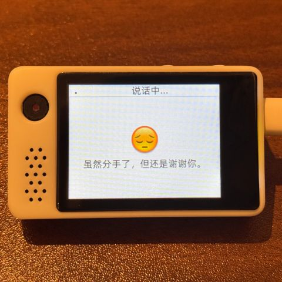
  </a>
  <a href="docs/v1/espbox3.jpg" target="_blank" title="涔愰懌 ESP32-S3-BOX3">
    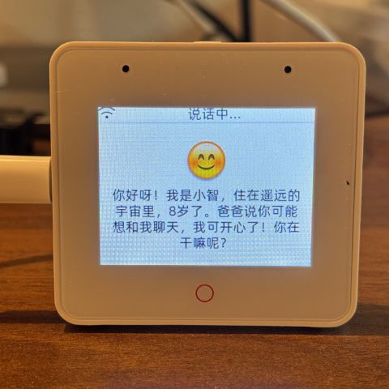
  </a>
  <a href="docs/v1/m5cores3.jpg" target="_blank" title="M5Stack CoreS3">
    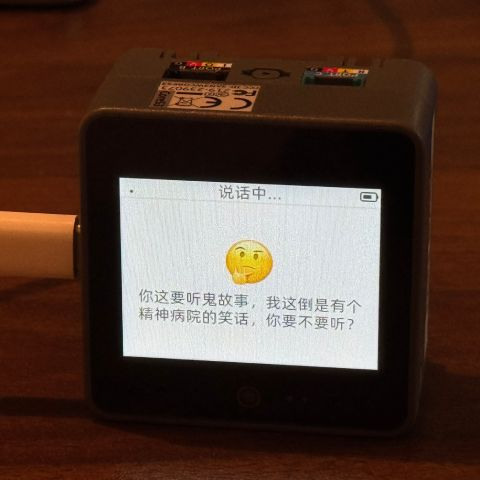
  </a>
  <a href="docs/v1/atoms3r.jpg" target="_blank" title="AtomS3R + Echo Base">
    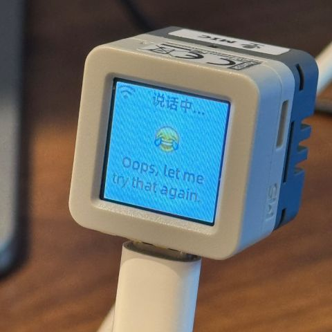
  </a>
  <a href="docs/v1/magiclick.jpg" target="_blank" title="绁炲鎸夐挳 2.4">
    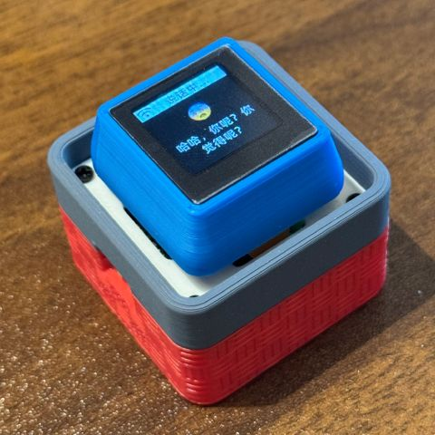
  </a>
  <a href="docs/v1/waveshare.jpg" target="_blank" title="寰洩鐢靛瓙 ESP32-S3-Touch-AMOLED-1.8">
    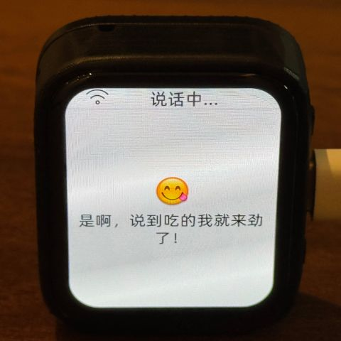
  </a>
  <a href="docs/v1/lilygo-t-circle-s3.jpg" target="_blank" title="LILYGO T-Circle-S3">
    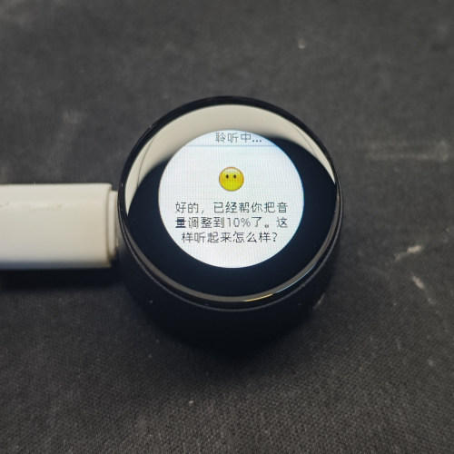
  </a>
  <a href="docs/v1/xmini-c3.jpg" target="_blank" title="铏惧摜 Mini C3">
    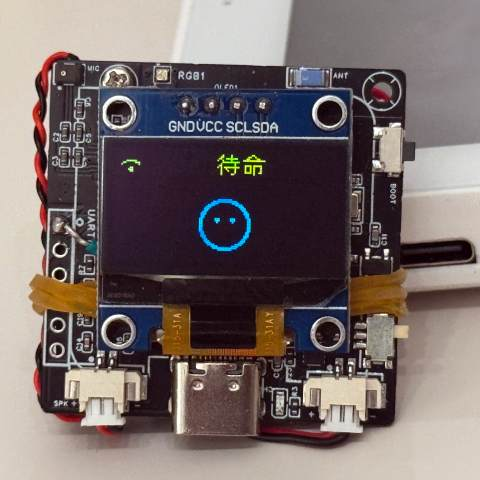
  </a>
  <a href="docs/v1/movecall-cuican-esp32s3.jpg" target="_blank" title="CuiCan">
    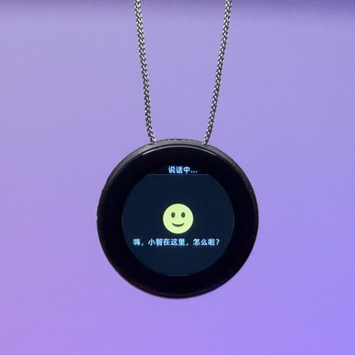
  </a>
  <a href="docs/v1/wmnologo_xingzhi_1.54.jpg" target="_blank" title="鏃犲悕绉戞妧Nologo-鏄熸櫤-1.54">
    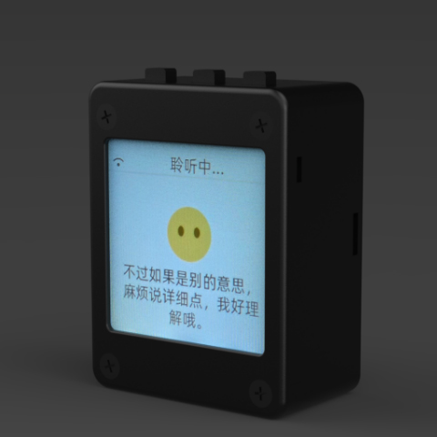
  </a>
  
  <a href="docs/v1/esp-hi.jpg" target="_blank" title="ESP-HI 瓒呬綆鎴愭湰鏈哄櫒鐙?>
    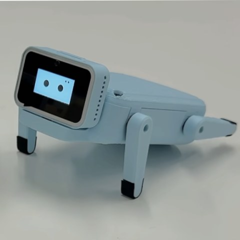
  </a>

## 杞欢

### 鍥轰欢鐑у綍

鏂版墜绗竴娆℃搷浣滃缓璁厛涓嶈鎼缓寮€鍙戠幆澧冿紝鐩存帴浣跨敤鍏嶅紑鍙戠幆澧冪儳褰曠殑鍥轰欢銆?

鍥轰欢榛樿鎺ュ叆 [xiaozhi.me](https://xiaozhi.me) 瀹樻柟鏈嶅姟鍣紝涓汉鐢ㄦ埛娉ㄥ唽璐﹀彿鍙互鍏嶈垂浣跨敤 Qwen 瀹炴椂妯″瀷銆?

馃憠 [鏂版墜鐑у綍鍥轰欢鏁欑▼](https://ccnphfhqs21z.feishu.cn/wiki/Zpz4wXBtdimBrLk25WdcXzxcnNS)

### 寮€鍙戠幆澧?

- Cursor 鎴?VSCode
- 瀹夎 ESP-IDF 鎻掍欢锛岄€夋嫨 SDK 鐗堟湰 5.4 鎴栦互涓?
- Linux 姣?Windows 鏇村ソ锛岀紪璇戦€熷害蹇紝涔熷厤鍘婚┍鍔ㄩ棶棰樼殑鍥版壈
- 鏈」鐩娇鐢?Google C++ 浠ｇ爜椋庢牸锛屾彁浜や唬鐮佹椂璇风‘淇濈鍚堣鑼?

### 寮€鍙戣€呮枃妗?

- [MCP 鍗忚鐗╄仈缃戞帶鍒剁敤娉曡鏄嶿(docs/mcp-usage.md) - 浜嗚В濡備綍閫氳繃 MCP 鍗忚鎺у埗鐗╄仈缃戣澶?
- [MCP 鍗忚浜や簰娴佺▼](docs/mcp-protocol.md) - 璁惧绔?MCP 鍗忚鐨勫疄鐜版柟寮?
- [MQTT + UDP 娣峰悎閫氫俊鍗忚鏂囨。](docs/mqtt-udp.md)
- [涓€浠借缁嗙殑 WebSocket 閫氫俊鍗忚鏂囨。](docs/websocket.md)

## 澶фā鍨嬮厤缃?

濡傛灉浣犲凡缁忔嫢鏈変竴涓皬鏅?AI 鑱婂ぉ鏈哄櫒浜鸿澶囷紝骞朵笖宸叉帴鍏ュ畼鏂规湇鍔″櫒锛屽彲浠ョ櫥褰?[xiaozhi.me](https://xiaozhi.me) 鎺у埗鍙拌繘琛岄厤缃€?

馃憠 [鍚庡彴鎿嶄綔瑙嗛鏁欑▼锛堟棫鐗堢晫闈級](https://www.bilibili.com/video/BV1jUCUY2EKM/)

## 鐩稿叧寮€婧愰」鐩?

鍦ㄤ釜浜虹數鑴戜笂閮ㄧ讲鏈嶅姟鍣紝鍙互鍙傝€冧互涓嬬涓夋柟寮€婧愮殑椤圭洰锛?

- [xinnan-tech/xiaozhi-esp32-server](https://github.com/xinnan-tech/xiaozhi-esp32-server) Python 鏈嶅姟鍣?
- [joey-zhou/xiaozhi-esp32-server-java](https://github.com/joey-zhou/xiaozhi-esp32-server-java) Java 鏈嶅姟鍣?
- [AnimeAIChat/xiaozhi-server-go](https://github.com/AnimeAIChat/xiaozhi-server-go) Golang 鏈嶅姟鍣?
- [hackers365/xiaozhi-esp32-server-golang](https://github.com/hackers365/xiaozhi-esp32-server-golang) Golang 鏈嶅姟鍣?

浣跨敤灏忔櫤閫氫俊鍗忚鐨勭涓夋柟瀹㈡埛绔」鐩細

- [huangjunsen0406/py-xiaozhi](https://github.com/huangjunsen0406/py-xiaozhi) Python 瀹㈡埛绔?
- [TOM88812/xiaozhi-android-client](https://github.com/TOM88812/xiaozhi-android-client) Android 瀹㈡埛绔?
- [100askTeam/xiaozhi-linux](http://github.com/100askTeam/xiaozhi-linux) 鐧鹃棶绉戞妧鎻愪緵鐨?Linux 瀹㈡埛绔?
- [78/xiaozhi-sf32](https://github.com/78/xiaozhi-sf32) 鎬濇緢绉戞妧鐨勮摑鐗欒姱鐗囧浐浠?
- [QuecPython/solution-xiaozhiAI](https://github.com/QuecPython/solution-xiaozhiAI) 绉昏繙鎻愪緵鐨?QuecPython 鍥轰欢

## 鍏充簬椤圭洰

杩欐槸涓€涓敱铏惧摜寮€婧愮殑 ESP32 椤圭洰锛屼互 MIT 璁稿彲璇佸彂甯冿紝鍏佽浠讳綍浜哄厤璐逛娇鐢紝淇敼鎴栫敤浜庡晢涓氱敤閫斻€?

鎴戜滑甯屾湜閫氳繃杩欎釜椤圭洰锛岃兘澶熷府鍔╁ぇ瀹朵簡瑙?AI 纭欢寮€鍙戯紝灏嗗綋涓嬮閫熷彂灞曠殑澶ц瑷€妯″瀷搴旂敤鍒板疄闄呯殑纭欢璁惧涓€?

濡傛灉浣犳湁浠讳綍鎯虫硶鎴栧缓璁紝璇烽殢鏃舵彁鍑?Issues 鎴栧姞鍏?[Discord](https://discord.gg/bXqgAfRm) 鎴?QQ 缇わ細1011329060

## Star History

<a href="https://star-history.com/#78/xiaozhi-esp32&Date">
 <picture>
   <source media="(prefers-color-scheme: dark)" srcset="https://api.star-history.com/svg?repos=78/xiaozhi-esp32&type=Date&theme=dark" />
   <source media="(prefers-color-scheme: light)" srcset="https://api.star-history.com/svg?repos=78/xiaozhi-esp32&type=Date" />
   
 </picture>
</a>
